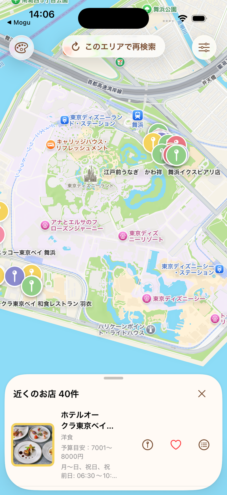
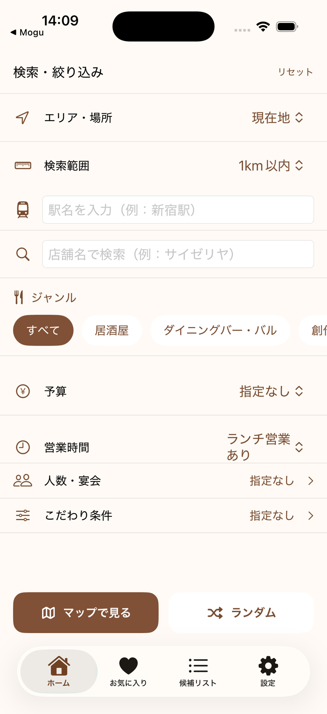
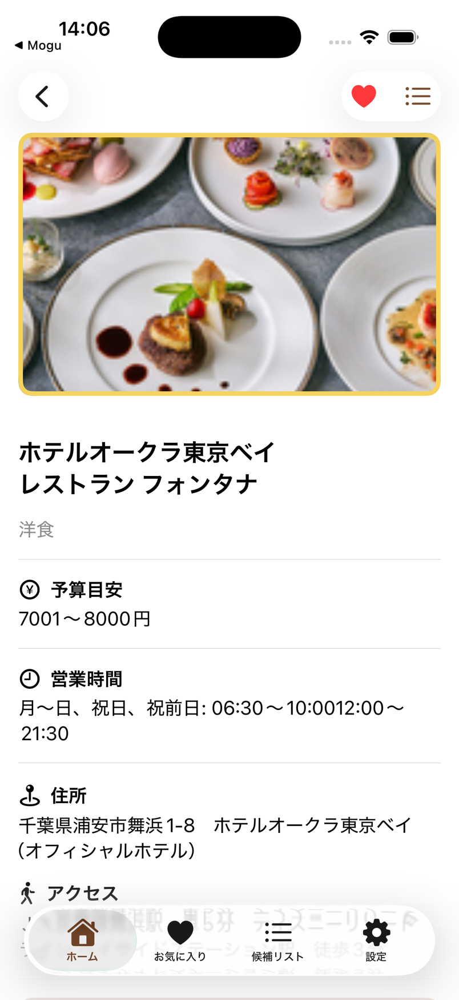
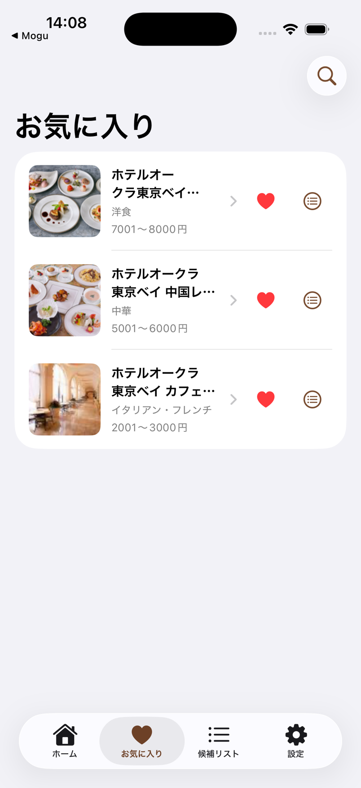
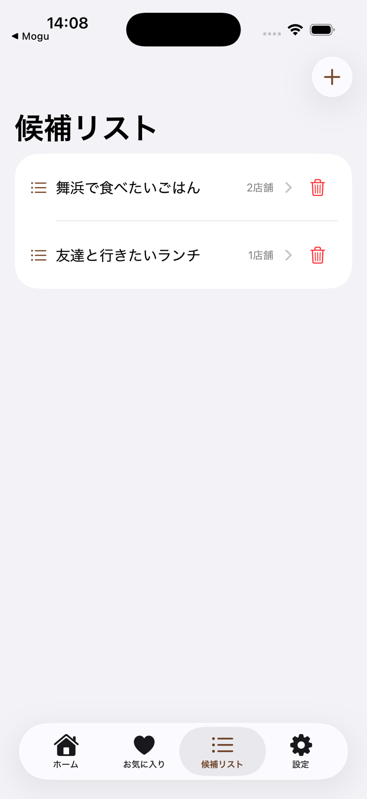
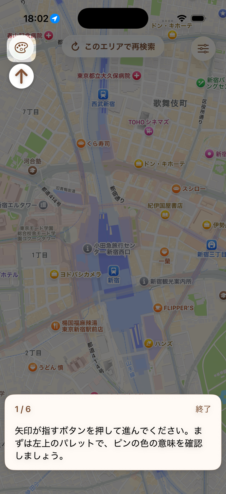

# Mogu 🍽️

### いっしょにお店探し♪

Mogu（モグ）は、近くの飲食店を探したり、気になるお店をまとめたりできるiPhoneアプリです。

「今日は何を食べよう？」「お店が多すぎて決められない！」というときに、楽しくお店を探せるアプリを作りたいと思い、開発しました。

## 🍴 主な機能

### ① 地図からお店を探す

現在地や指定した駅の近くにある飲食店を、地図から探せます。

料理のジャンルに合わせてピンを17色に分けており、左上のパレットボタンから色の一覧を確認できます。気になるピンを押すと、お店の詳しい情報を見ることができます。

### ② 条件を絞って検索

店舗名、料理のジャンル、予算、検索範囲、営業時間、利用人数・宴会条件、その他のこだわり条件などを組み合わせて検索できます。

行きたい場所や希望に合わせて、自分に合ったお店を探せます。

### ③ お気に入り登録

気になったお店をお気に入りに保存して、あとからまとめて確認できます。

お気に入りの中でも条件を指定して絞り込んだり、ランダムで1店舗を選んだりできます。

### ④ 候補リスト

「友達と行きたいお店」「今度行ってみたいカフェ」など、好きな名前をつけて候補リストを作れます。

リストは複数作成でき、LINEなどで友達に共有することもできます。

### ⑤ ランダムでお店を決める

「どこに行こうか決められない！」というときは、検索条件に合ったお店の中からランダムで1店舗を選べます。

自分で作った候補リストの中からも選べるので、迷ったときのお店選びに役立ちます。

### ⑥ チュートリアル

初めてアプリを使う人でも迷わないように、実際にボタンを押しながら操作を覚えられるチュートリアルを用意しました。

設定画面の「チュートリアルをもう一度見る」から、何度でも体験できます。

## 📸 アプリの画面

| ホーム | 検索・絞り込み | 店舗詳細 |
| :---: | :---: | :---: |
|  |  |  |

| お気に入り | 候補リスト | チュートリアル |
| :---: | :---: | :---: |
|  |  |  |

画像提供：ホットペッパー グルメ

## 🛠 使用した技術

| 技術 | 使用した目的 |
| --- | --- |
| Swift | アプリの開発 |
| SwiftUI | 画面の作成 |
| MapKit | 地図や店舗ピンの表示 |
| Core Location | 現在地の取得 |
| Hot PepperグルメAPI | 飲食店情報の取得 |
| UserDefaults / AppStorage | お気に入り・候補リストの保存、設定の管理 |
| Git / GitHub | コードの管理 |
| ChatGPT / Codex | 開発の相談、実装の補助、コードの見直し |

## 🎨 デザインでこだわったこと

全体をベージュとブラウンでまとめ、やわらかく親しみやすい雰囲気にしています。

料理のジャンルごとにピンの色を分け、地図を見るだけでどんなお店があるのかわかりやすくしました。

地図の上にある「ジャンルの色」「このエリアで再検索」「検索・絞り込み」の3つのボタンには、タップするとガラスのように反応するLiquid Glassを使いました。

小さい文字が見づらい方にも使いやすいように、設定画面から文字の大きさを変えられるようにしました。

## 💡 開発で意識したこと

実際に家族や先生、友人にアプリを使ってもらい、いただいた意見を取り入れながら開発を進めました。特に、初めて使う人でも迷わず操作できるように、ボタンの位置や画面の見やすさを工夫しました。

同じような処理はできるだけ一つにまとめ、あとから修正しやすいコードにすることも心がけました。

## 📱 開発環境

- 開発ツール：Xcode 26.3
- 対応端末：iPhone（iOS 26.2以降）
- 使用言語：Swift

## 📖 使用しているAPI

飲食店情報の取得には、リクルートが提供する「Hot PepperグルメAPI」を利用しています。地図の表示にはAppleのMapKitを使用しています。

Powered by [ホットペッパーグルメ Webサービス](https://webservice.recruit.co.jp/)

## 🌷 おわりに

「何食べよう？」と迷ったときに、気軽に開いてもらえるアプリを目指しました。

Moguを通して、いつものお店探しが少しでも楽しくなったら嬉しいです。
